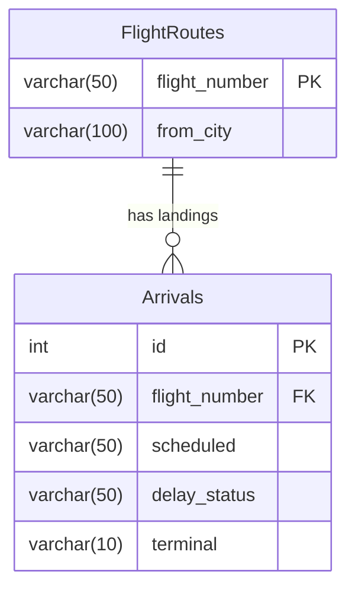

# Flight Arrivals Management System (`JDBC_FlightManager`)

**Course:** Software Engineering Methods (Academic Year 2026–2027)
**Institution:** Braude College of Engineering | Department of Software Engineering
**Database Engine:** MySQL 8.0+ | **Language:** Java 25 LTS (JDBC)

---

## 1. Project Description
`JDBC_FlightManager` is the Data Access Layer (DAL) for an airport flight-arrivals management
system. It ingests raw landing telemetry from `arrived_flights.csv` (299 records) into a temporary
flat table, normalizes that table into a Third Normal Form (3NF) relational schema (`FlightRoutes`
and `Arrivals`), and manages arrival statuses through JDBC. The project demonstrates both a legitimate
single-row update and a batched multi-row update, then uses a live SQL Injection attack against a
vulnerable `Statement` to motivate a secure refactor to a parameterized `PreparedStatement`.

---

## 2. Engineering Team Details (Single-Workstation Driver–Navigator)

| Role | Full Name | Student ID | Braude Academic Email |
| :--- | :--- | :--- | :--- |
| **Student A** | `[Enter Student A Full Name]` | `[Enter ID]` | `[studentA@e.braude.ac.il]` |
| **Student B** | `[Enter Student B Full Name]` | `[Enter ID]` | `[studentB@e.braude.ac.il]` |

* **Group Number:** `G[XX]`
* **GitHub Repository URL:** `https://github.com/Shadadabah/JDBC_FlightManager`

---

## 3. Technology Stack
* **Runtime & JDK:** BellSoft Liberica Full JDK 25 LTS
* **Database Server:** MySQL Server 8.0+ (`FlightDB` schema)
* **JDBC Driver:** MySQL Connector/J 9.5.0 (`mysql-connector-j-9.5.0.jar`)
* **IDE & Database Tooling:** IntelliJ IDEA Ultimate (built-in Database console & SQL Generator)
* **Local AI Assistant:** LM Studio (`Qwen2.5-Coder-7B-Instruct`) integrated via the Continue plugin
* **Version Control:** Git & GitHub

---

## 4. Database Normalization (3NF) & Functional Dependencies (F)

### 4.1 Functional Dependencies (F) in `rawflights`
The flat import `rawflights(scheduled, flight, fromC, delay, terminal)` carries the dependency:

* **flight -> fromC** — a flight number uniquely determines its departure city.

The remaining attributes (`scheduled`, `delay`, `terminal`) describe an individual landing event
rather than the route, so they depend on the surrogate event identity, not on `flight`.

### 4.2 Why `rawflights` Violated 3NF
Because `flight -> fromC` holds but `flight` is not the key of a landing-event row, `fromC` is a
**transitively dependent** attribute stored redundantly on every row for that flight. This causes:

* **Update anomaly:** correcting a route's city would require editing many rows, risking inconsistency.
* **Insertion anomaly:** a route's city could not be recorded until a landing event for it exists.
* **Deletion anomaly:** removing the last landing of a flight would erase the route's city entirely.

Decomposing into `FlightRoutes` (route facts) and `Arrivals` (event facts) removes the transitive
dependency: every non-key attribute now depends only on the key of its own table.

### 4.3 Decomposed 3NF Relational Schema
* **`FlightRoutes`** — `flight_number VARCHAR(50)` **PK**, `from_city VARCHAR(100) NOT NULL`
* **`Arrivals`** — `id INT AUTO_INCREMENT` **PK**, `flight_number VARCHAR(50) NOT NULL` **FK ->
  FlightRoutes(flight_number) ON DELETE CASCADE**, `scheduled VARCHAR(50)`, `delay_status VARCHAR(50)`,
  `terminal VARCHAR(10)`

---

## 5. Independent AI Prompt (Part 4 – `FlightViewer.java`)

```text
Write a complete Java class named FlightViewer with a main method.
Connect to the MySQL database FlightDB using DriverManager with the URL
"jdbc:mysql://localhost:3306/FlightDB?allowLoadLocalInfile=true&allowPublicKeyRetrieval=true&serverTimezone=Asia/Jerusalem&useSSL=false"
and user "root", prompting for the root password via Scanner, all inside try-with-resources.
Then prompt the user for a target Terminal number (valid terminals in the dataset are 2, 3, 4, 5).
Using a secure PreparedStatement with a '?' placeholder, run a SELECT that INNER JOINs Arrivals and
FlightRoutes on flight_number, filters WHERE Arrivals.terminal = ?, and sorts ORDER BY Arrivals.scheduled ASC.
Because the terminal column is VARCHAR(10), bind the parameter with pstmt.setString(1, terminal).
Print id, flight_number, from_city, scheduled, delay_status and terminal of each row in a formatted table,
followed by the total count.
```

---

## 6. Entity Relationship Diagram (ERD)



---

## 7. Security Audit Summary (Part 5 – SQL Injection Mitigation)
* **Attack Payload Tested:** `Landed' #`
* **Vulnerability Analysis (`Statement`):** `SimpleFlightUpdater` built the command by concatenating
  user input into the SQL text. The payload's `'` closed the `delay_status` string literal early and
  `#` began a MySQL line comment, so the engine discarded the `WHERE flight_number = 'LX354'` clause.
  The resulting statement — `UPDATE Arrivals SET delay_status = 'Landed' #...` — overwrote **all 299
  rows** instead of one.
* **Remediation (`PreparedStatement`):** The refactor sends a fixed template
  `UPDATE Arrivals SET delay_status = ? WHERE flight_number = ?` to the server, which compiles it with
  the placeholders in place. User input is then bound as a **typed parameter**, transmitted separately
  and never parsed as SQL. The same payload is stored literally and only the single targeted row
  changes, fully neutralizing the injection.

---

## 8. License
Distributed under the **Braude College Academic License** (Software Engineering Methods, 2026–2027).
